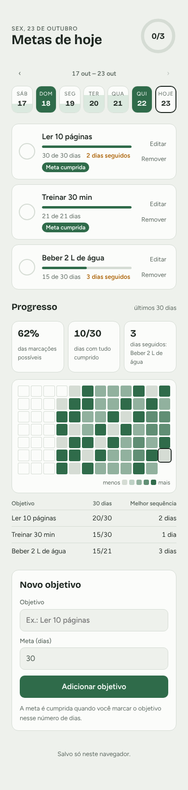

# Metas do Dia

Um app simples para definir objetivos que você quer cumprir todo dia e acompanhar se está conseguindo. Você cadastra o objetivo, escolhe em quantos dias quer cumpri-lo e marca cada dia em que fez. O app mostra o progresso até a meta, as sequências de dias seguidos e um resumo dos últimos 30 dias.

É uma página só (`index.html`), feita com HTML, CSS e JavaScript puros, sem dependências e sem etapa de build. Foi pensada para rodar como Artifact no claude.ai, mas também funciona aberta direto no navegador.

<p align="center">
  
</p>

## Funcionalidades

### Objetivos com meta em dias

Cada objetivo tem um nome (por exemplo, "Ler 10 páginas") e uma meta em dias (de 1 a 3650, 30 por padrão). A meta é cumprida quando você marca o objetivo nesse número de dias, seguidos ou não. A barra de cada objetivo mostra quantos dias já foram marcados, e o selo **Meta cumprida** aparece ao chegar lá.

Quando ainda não há nenhum objetivo, o app sugere alguns para começar com um toque (beber água, ler, treinar, dormir cedo).

### Marcação diária

Toque no círculo ao lado de um objetivo para marcar que cumpriu no dia escolhido; toque de novo para desmarcar. O anel no topo mostra quantos objetivos do dia já foram cumpridos.

Dá para marcar dias anteriores: basta escolher o dia na faixa da semana. Um objetivo novo já aceita marcações dos 6 dias anteriores à sua criação, para você registrar o que fez na última semana.

### Sequências

Abaixo de cada objetivo aparece **N dias seguidos** quando você tem uma sequência de 2 dias ou mais. A sequência conta até hoje; se hoje ainda não foi marcado, ela conta até ontem, então não se perde antes de o dia acabar.

### Editar e remover

- **Editar** abre o objetivo no próprio lugar para mudar o nome e a meta. As marcações já feitas continuam valendo. **Esc** ou **Cancelar** descarta a edição.
- **Remover** pede confirmação (toque de novo em **Confirmar?** em até 3 segundos) e apaga o objetivo junto com todas as marcações dele.

### Navegação pelas semanas

A faixa no topo mostra 7 dias. Cada dia fica preenchido conforme a parte dos objetivos cumprida, e fica todo verde quando tudo foi cumprido.

- As setas **‹** e **›** voltam e avançam uma semana. Não é possível ir além de hoje nem antes do primeiro dia com dados.
- O botão **Hoje** aparece quando você está vendo outro dia e volta para o dia atual.
- Com a página aberta, o app passa para o novo dia sozinho depois da meia-noite.

### Progresso

A seção **Progresso** aparece quando existe pelo menos um objetivo e resume os últimos 30 dias:

- **% das marcações possíveis**: quantas marcações você fez em relação a todas que poderia ter feito.
- **Dias com tudo cumprido**: em quantos dias todos os objetivos foram marcados.
- **Recorde de dias seguidos**: a maior sequência entre todos os objetivos, com o nome de qual foi.
- **Mapa das últimas 12 semanas**: cada quadrado é um dia, mais escuro quanto mais foi cumprido. Toque num quadrado para abrir aquele dia.
- **Tabela por objetivo**: dias marcados nos últimos 30 dias e a melhor sequência de cada um.

Um objetivo só conta para os dias a partir da sua criação, então criar um objetivo novo não derruba as porcentagens de dias antigos.

### Tema claro e escuro

O app segue o tema do sistema automaticamente.

## Como os dados são salvos

O app escolhe onde salvar ao abrir:

- **No claude.ai (Artifact)**: os dados ficam salvos na sua conta, no banco de dados do Artifact, em um documento só seu (`data/users/{seu id}/state`). Assim eles acompanham você em outros aparelhos, e cada pessoa que abre o Artifact tem os próprios objetivos. A mensagem no rodapé diz **Salvo na sua conta.**
- **Fora do claude.ai**: os dados ficam no `localStorage` do navegador, na chave `metas-do-dia`. Eles só existem naquele navegador e somem se você limpar os dados do site. O rodapé diz **Salvo só neste navegador.**

Algumas proteções:

- Nenhuma mudança é gravada antes de os dados salvos terminarem de carregar, para não apagar o que já existe. Se você tocar em algo nesse meio tempo, o app pede para tentar de novo em instantes.
- As mudanças são salvas automaticamente, um instante depois da última alteração.
- Se o armazenamento do navegador encher, o app avisa no rodapé.

Os dados têm este formato:

```json
{
  "goals": [
    { "id": "k3j9x2ab", "name": "Ler 10 páginas", "target": 30, "createdAt": "2026-10-01" }
  ],
  "days": {
    "2026-10-23": ["k3j9x2ab"]
  }
}
```

`goals` lista os objetivos e `days` guarda, para cada data, os ids dos objetivos marcados naquele dia.

## Como rodar

### Como Artifact no claude.ai

Peça ao Claude para publicar o `index.html` como Artifact (ou atualizar o Artifact existente com a versão nova do arquivo). Para salvar os dados na conta, o Artifact precisa das capacidades de banco de dados (`db`) e de usuário (`user`). Sem elas, o app continua funcionando e salva no navegador.

### No navegador, localmente

Não precisa instalar nada. Abra o `index.html` direto no navegador, ou sirva a pasta com um servidor simples:

```sh
python3 -m http.server 8000
```

e acesse <http://localhost:8000>. Nesse modo os dados ficam no `localStorage` do navegador.

## Estrutura

```
index.html   o app inteiro: estilos, marcação e script
docs/        imagens usadas neste README
```
